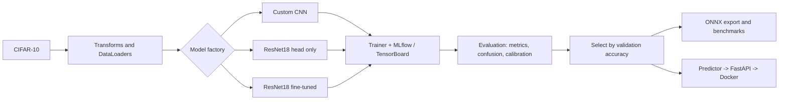
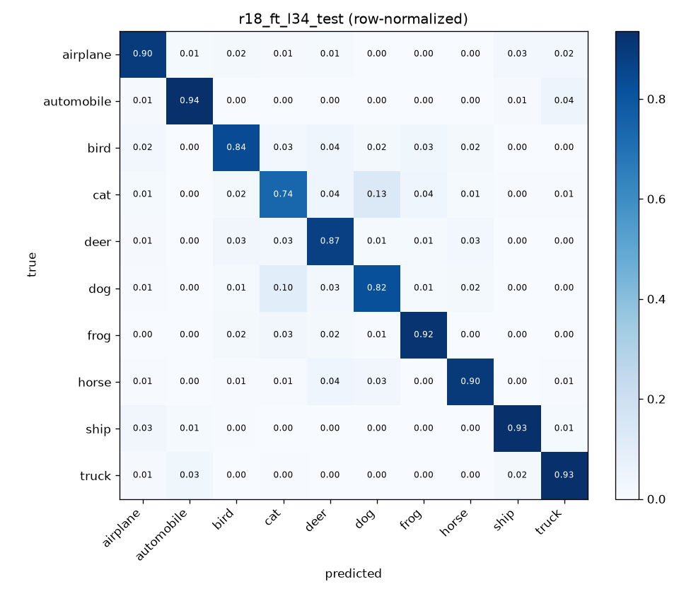
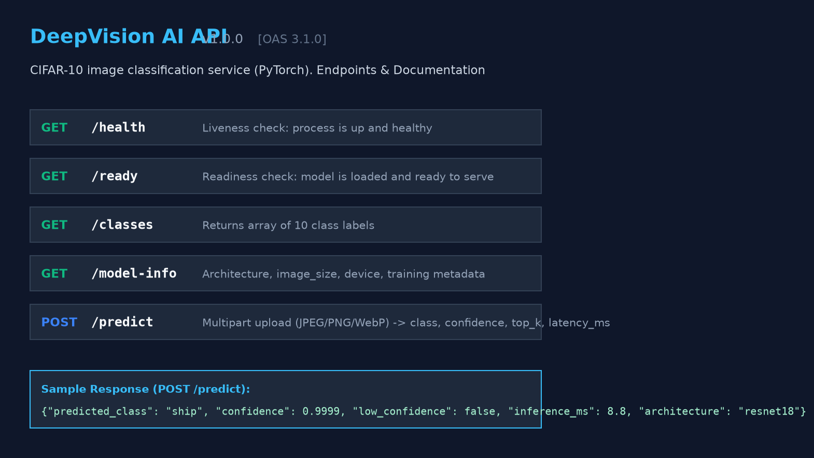

# DeepVision AI


End-to-end deep learning project on **CIFAR-10** with **PyTorch**: a CNN trained from scratch, an ImageNet-pretrained **ResNet18**
(feature extraction) and a **fine-tuned ResNet18**, compared under a leak-free evaluation protocol, tracked with MLflow,
benchmarked (ONNX, quantization), and served as a tested **FastAPI + Docker** service.

## Highlights
- Three training strategies compared on the same split, with train/validation/test kept strictly separate
- Real training engine: AdamW/SGD, cosine scheduling, dropout, BatchNorm, AMP, gradient clipping and accumulation, early stopping
- Two-stage fine-tuning with discriminative learning rates and BatchNorm-aware freezing
- Evaluation beyond accuracy: precision/recall/F1, confusion matrices, calibration (ECE), misclassification galleries
- Reproducible: YAML configs, seeds, config hash + git commit logged to MLflow
- Production practices: input validation, tests (pytest), linting (ruff), GitHub Actions CI, Docker

## Architecture


## Results
<!-- RESULTS:START -->
| model | run | arch | strategy | img_size | params | trainable | train_s | train_acc | val_acc | test_acc | test_P | test_R | test_F1 | ECE | size_MB | cpu_ms_bs1 |
|---|---|---|---|---|---|---|---|---|---|---|---|---|---|---|---|---|
| A | p6_improved_adamw_cos | improved_cnn | scratch | 32 | 620586 | 620586 | 683 | 0.7785 | 0.8014 | 0.7963 | 0.7951 | 0.7963 | 0.7955 | 0.0096 | 2.369 | 0.618 |
| B | r18_head | resnet18 | head_only | 64 | 11181642 | 5130 | 1090 | 0.7082 | 0.7338 | 0.7235 | 0.7259 | 0.7235 | 0.7211 | 0.0778 | 42.691 | 8.393 |
| C | r18_ft_l34 | resnet18 | finetune_partial | 64 | 11181642 | 10498570 | 2668 | 0.9121 | 0.8812 | 0.8783 | 0.8782 | 0.8783 | 0.878 | 0.0241 | 42.691 | 8.671 |

Selection rule: highest **validation** accuracy (with any override documented in `artifacts/final/model_info.json`). Final model: **r18_ft_l34** (highest validation accuracy).

Test metrics are from one evaluation per model and were not used for selection. `cpu_ms_bs1` = median single-image latency, PyTorch fp32 on this machine's CPU, model only.
<!-- RESULTS:END -->

Full methodology, hyperparameters and error analysis: [`reports/final_report.md`](reports/final_report.md). Model card: [`MODEL_CARD.md`](MODEL_CARD.md).



## Quickstart
Requires Python 3.11. Install PyTorch for your hardware first (https://pytorch.org/get-started/locally/).
```bash
python -m venv .venv && source .venv/bin/activate      # Windows: .venv\Scripts\Activate.ps1
pip install -r requirements.txt
pip install -e .
python scripts/download_data.py
```

### Train (config-driven, tracked)
```bash
python scripts/run_experiment.py --config configs/cnn.yaml
python scripts/run_experiment.py --config configs/resnet18_head.yaml
python scripts/run_experiment.py --config configs/resnet18_finetune.yaml
mlflow ui --backend-store-uri sqlite:///mlflow.db
```

### Evaluate, benchmark and select
```bash
python scripts/evaluate.py --checkpoint artifacts/checkpoints/<run>_best.pt --split val
python scripts/evaluate.py --checkpoint artifacts/checkpoints/<run>_best.pt --split test   # once, at the end
python scripts/optimize_model.py --checkpoint artifacts/checkpoints/<run>_best.pt
python scripts/select_final_model.py --runs <A> <B> <C>
```

### Serve
Model weights are not stored in git. Download `model.pt` from the [Releases](../../releases) page into `artifacts/final/`
(or produce it with the steps above).
```bash
uvicorn api.main:app                                   # http://127.0.0.1:8000/docs
docker compose up --build                              # containerised, mounts artifacts/final
python scripts/predict_client.py demo_images/cat.png
```



## API
| Method | Path | Purpose |
|---|---|---|
| GET | `/health` | liveness |
| GET | `/ready` | readiness (model loaded) |
| GET | `/classes`, `/model-info` | class names, model metadata |
| POST | `/predict?top_k=3` | multipart `file` (JPEG/PNG/WebP, max 5 MB) -> class, confidence, top-k, latency |

```bash
curl -X POST -F "file=@demo_images/cat.png;type=image/png" "http://localhost:8000/predict?top_k=3"
```

## Project structure
```
src/deepvision/   data, models, training, evaluation, tracking, optimization, inference, utils
api/              FastAPI app (schemas, dependencies, endpoints)
configs/          YAML experiment configs
scripts/          training, evaluation, benchmarking, reporting entry points
tests/            pytest suite
learning/         step-by-step study scripts (phases 1-11)
reports/          experiment logs and the final report
```

## Testing
```bash
pytest && ruff check .
```
CI runs both on every push, then builds the Docker image and smoke-tests it.

## Limitations
Trained on 32x32 CIFAR-10 images. It always predicts one of 10 classes, even for unrelated images, and the confidence flag
is only a heuristic. Results come from limited seeds. See the model card and final report for details.

## License and acknowledgements
Code: MIT (see `LICENSE`). Dataset: CIFAR-10 (Krizhevsky, 2009). Pretrained weights: torchvision ImageNet ResNet18 (check their terms before commercial use).
